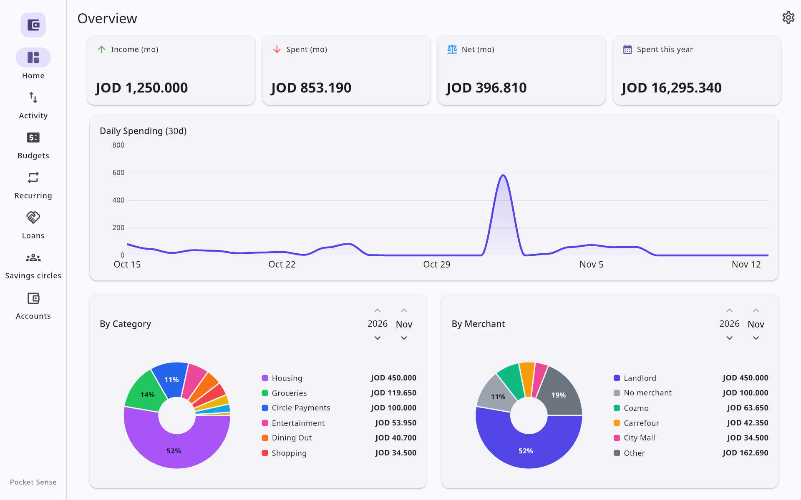
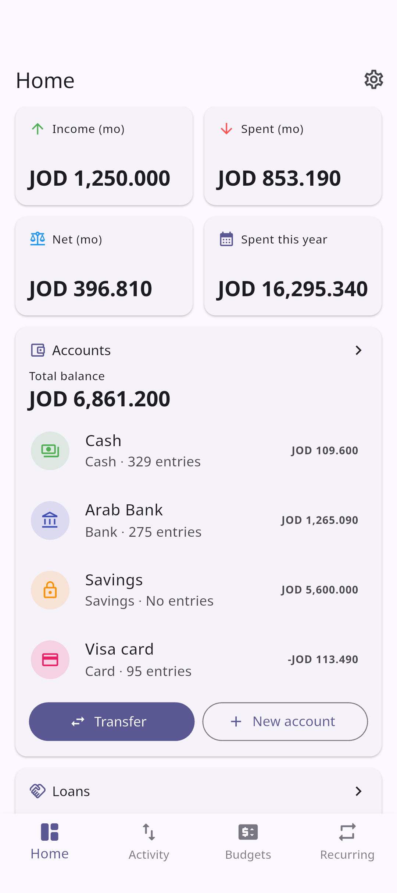
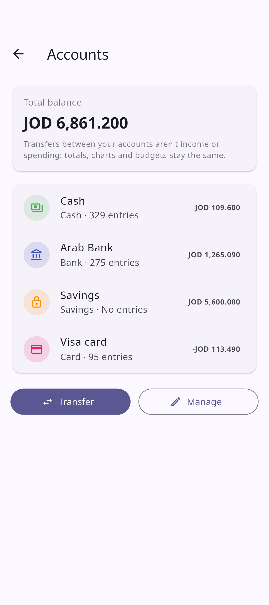
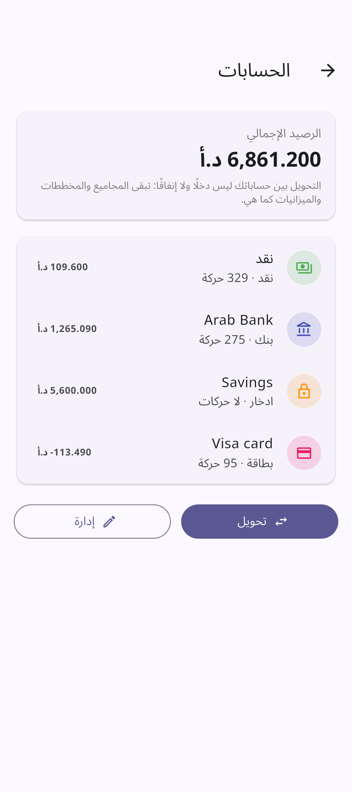

<p align="center">
  
</p>

## ⚠️ Before you update

- **Update every paired device.** This version stores accounts, so its data is a newer version. Sync only works between devices on the same version: until all your paired devices have updated, they won't sync with each other.
- **There's no going back to 2.4.2.** The first time 2.5.0 opens, it upgrades your data and puts every entry you already have into one account, **Cash**. An older version can't open it afterwards, or import a backup made by 2.5.0. Your entries, totals and charts stay exactly as they were.

## 💳 Accounts

Keep track of where your money is: cash, a bank account, savings, a card (#16).

- Everyone starts with one account, **Cash**, and adds the ones they need in **Settings → Data → Accounts**, or from Home. Each has an opening balance; a card can start below zero.
- Home's new **Accounts** section shows the total and each balance. Tap an account to see its entries and transfers, and what came in and went out this month.
- **Transfer** moves money between your accounts. It isn't income or spending, so your totals, charts and budgets stay the same.
- With only Cash, the entry form looks as before. Add a second account and it gets an **Account** field; new entries go into the account you choose as default.
- **Close** an account you stopped using: money left in it moves to another account (a card's debt is paid off from it), its history stays, and you can reopen it. **Delete** is for mistakes: everything in it moves to the account you pick, so no money is lost.

<p align="center">
  
  &nbsp;
  
  &nbsp;
  
</p>

## 🔔 Reminders for bills and loans

A recurring item, or a loan with a due date, can remind you on the day or 1, 3 or 7 days before, at a **due time** you pick (#11).

- **Create Transaction** on the notification records the bill, or opens Record repayment for a loan, after your app lock. **Dismiss** closes it.
- Notifications show no amounts unless you turn on **Settings → Security → Amounts in reminders**.
- On Android they come even when the app is closed. Phones that stop apps' alarms (Xiaomi, Samsung and others) get a hint and a button to fix it. On Linux and Windows they show while the app is open, and any you missed when you open it.

## 📄 CSV import and export

**Settings → Data → Export Transactions** and **Import Transactions** use a plain spreadsheet file: date, type, amount, description, category, merchant and account (#13). **Categories** and **Merchants** have their own Import CSV and Export CSV in their ⋮ menu.

Every import shows a preview first: each row New, Duplicate or Rejected with the reason. Nothing is saved until you tap Import, and importing the same file twice adds nothing.

## 🏠 Your Home page

- **Settings → Home page** puts Home's sections in the order you want and hides the ones you don't need (#23).
- **By Category** and **By Merchant** have their own month picker, like Monthly Income vs Spending, which now sits right after them.

## 🪟 Windows

Pocket Sense now runs on Windows 10 and 11 (x64), with the same encrypted database, sync and reminders as Linux (#8). Voice entry isn't on Windows yet. The installers aren't code-signed yet, so SmartScreen may warn about an unknown publisher: choose **More info → Run anyway**. The first time sync starts, allow Pocket Sense on private networks when Windows Defender Firewall asks.

## 🐧 Linux

- The AppImage now updates itself in place from GitHub releases with Gear Lever, AppImageUpdate or Shelly. The app itself still never goes online.
- Arch, CachyOS and Manjaro: [`linux/packaging/aur/PKGBUILD`](https://github.com/software-ace/PocketSense/blob/main/linux/packaging/aur/PKGBUILD) installs the release with `makepkg -si`.

## Changes and fixes

- **Settings → Backup:** Export data and Import data are now **Export Backup** and **Import Backup**, so they read apart from the CSV options.
- An amount with a decimal comma, like `12,5`, is now rejected instead of being read as 125. `1,234` still works.
- Pairing a device set up later no longer brings back the old name of a starter category you renamed, or one you deleted.

## Download
**Android**
- Also on **[F-Droid](https://f-droid.org/packages/ace.software.pocketsense/)**, which keeps it updated. It ships these same signed APKs, so you can switch between the two and keep your data.
- **`PocketSense-v2.5.0-arm64-v8a.apk`**: almost all modern Android phones. Use this one if unsure.
- `PocketSense-v2.5.0-armeabi-v7a.apk`: older 32-bit phones
- `PocketSense-v2.5.0-x86_64.apk`: emulators and Chromebooks

Installs as an update over any earlier version and keeps your data.

**Windows 10 or 11 (x64)**: pick one.
- **`PocketSense-v2.5.0-windows-x64-setup.exe`**: run it. It installs just for you without admin rights, or for everyone if you choose.
- `PocketSense-v2.5.0-windows-x64.msi`: installs for everyone on the PC, for example when deploying it across an organization.
- `PocketSense-v2.5.0-windows-x64.zip`: unpack it anywhere and run `pocket_sense.exe`.

**Linux (x86_64)**: pick one.
- **Debian, Ubuntu, Mint:** `PocketSense-v2.5.0-linux-x64.deb`
  ```sh
  sudo apt install ./PocketSense-v2.5.0-linux-x64.deb
  ```
- **Fedora, openSUSE:** `PocketSense-v2.5.0-linux-x64.rpm`
  ```sh
  sudo dnf install ./PocketSense-v2.5.0-linux-x64.rpm   # or: sudo zypper install
  ```
- **Any distro:** `PocketSense-v2.5.0-linux-x64.AppImage`. Make it executable and run it.
- **Any distro:** `PocketSense-v2.5.0-linux-x64.tar.gz`. Unpack it and run `./PocketSense/pocket_sense`.

All need glibc 2.35 or newer and a running keyring (GNOME Keyring or KWallet). With the AppImage or the tarball you also need GTK 3, and `parecord` for voice entry (`pulseaudio-utils` on Debian/Ubuntu/Fedora, `libpulse` on Arch).
