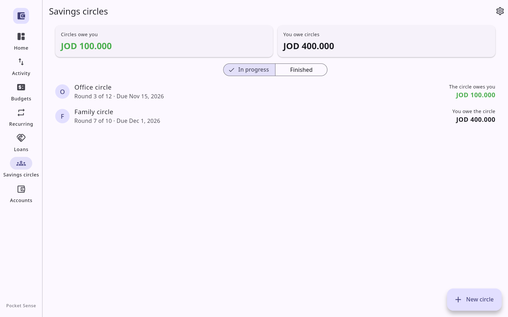
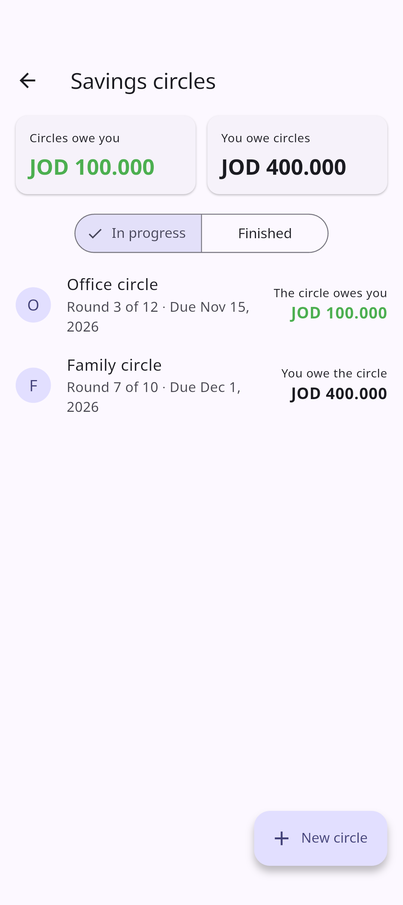
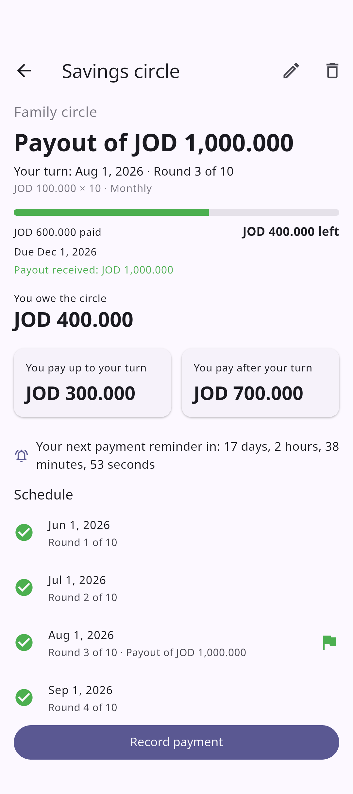
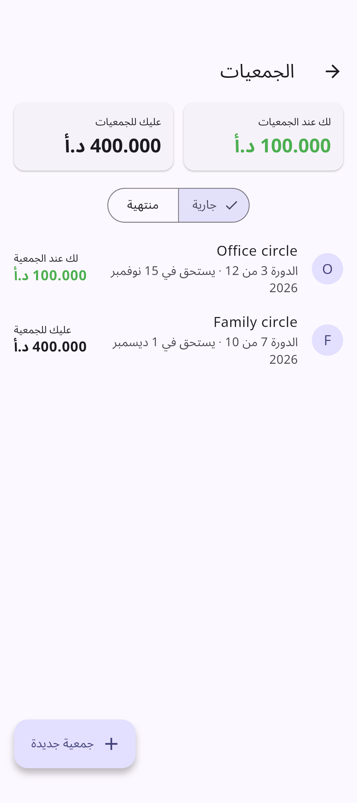

<p align="center">
  
</p>

## ⚠️ Before you update

- **Update every paired device.** This version stores savings circles, so its data is a newer version. Sync only works between devices on the same version: until all your paired devices have updated, they won't sync with each other.
- **There's no going back to 2.5.0.** The first time 2.6.0 opens, it upgrades your data. An older version can't open it afterwards, or import a backup made by 2.6.0. Your entries, totals and charts stay exactly as they were.

## 🤝 Savings circles (جمعيات)

Track the rotating savings circles you're in: everyone pays the same amount each round, and each round one member takes the whole pot (#22).

- Give a circle its **payment each round**, the **number of participants**, how often it's due (weekly, every two weeks or monthly), the **first payment**'s date and **your turn**. It works out the schedule, your **payout** and its date, and what you pay **up to your turn** and **after it**.
- Each circle shows where you stand. An early turn means **you owe the circle**, like a loan; a late one means **the circle owes you**, money you've saved ahead.
- **Record payment** and **Record payout** add ordinary entries (*Payment to Family*, *Payout from Family*) in the new **Circle Payments** and **Circle Payouts** categories, so your totals follow the cash. A part payment counts toward the next round, and a late round turns red.
- A reminder before each unpaid round, at the time you pick. **Create Transaction** on it opens Record payment.
- On a phone, the **Savings circles** card on Home is the way in; on the desktop, it's a tab in the side rail next to Loans and Accounts.

<p align="center">
  
  &nbsp;
  
  &nbsp;
  
</p>

## ⏱️ Countdown to your next reminder

A recurring item, a loan or a savings circle with a reminder shows a live countdown to it: *Your next reminder in: 2 days, 4 hours, 5 minutes, 9 seconds*.

## 🐧 Linux without a keyring

Pocket Sense keeps its encryption key in your desktop keyring. On a desktop without one (a bare window manager such as i3, sway or Hyprland without GNOME Keyring), a fresh install now asks for a **passphrase** instead of refusing to start. It keeps the key in a file locked with that passphrase, and asks for it each time it opens. If you forget it, the data can't be opened; **Forgot passphrase?** erases it so you can start over and import a backup.

The AppImage is now named `PocketSense-v2.6.0-x86_64.AppImage`. AppImages from 2.5.0 still find this update in place.

## Improvements

- **Activity:** a full list ends with **Show older entries**, so entries older than the newest 200 can be seen, edited and deleted. Lists of entries load much faster with years of data.
- **Savings circle fields** accept Arabic-Indic digits.
- **Sync** holds up better against someone else on the same Wi-Fi: a fake device can no longer stop it, pairing allows only a few codes each time its screen opens, and oversized requests are refused unread.

## Fixes

- A recurring item due on the 29th, 30th or 31st is due **every month**, on that day or the month's last. Before, some months had no due date or reminder and the next ones had two.
- Swiping an entry, category or merchant away and tapping **Cancel** keeps it on screen.
- Clearing the Activity search shows everything again, and a new entry or a sync no longer drops the search.
- Coming back to the app after the lock timeout covers it at once, before checking the PIN.
- **Changing the PIN** can no longer leave no PIN working if the app stops partway.
- Weekly budgets and the 30-day chart count the right days in a week when clocks change.
- A budget spent four times over shows **400%**, not 150%.
- Deleting a transfer asks first, like every other delete.
- Restoring a backup from an older version keeps the loan and circle categories, here and on your paired devices.
- Data from Pocket Sense 2.0 or 2.1 can be opened again.
- Renaming a merchant renames its entries all at once.
- A backup with a date the app never writes is refused before anything is replaced.
- A CSV exported in one currency imports again after you switch to one with fewer decimals.
- Closing or deleting an account always finishes, and saving a new account twice adds one.
- A category with a malformed colour no longer breaks the Categories screen.

## Download
**Android**
- Also on **[F-Droid](https://f-droid.org/packages/ace.software.pocketsense/)**, which keeps it updated. It ships these same signed APKs, so you can switch between the two and keep your data.
- **`PocketSense-v2.6.0-arm64-v8a.apk`**: almost all modern Android phones. Use this one if unsure.
- `PocketSense-v2.6.0-armeabi-v7a.apk`: older 32-bit phones
- `PocketSense-v2.6.0-x86_64.apk`: emulators and Chromebooks

Installs as an update over any earlier version and keeps your data.

**Windows 10 or 11 (x64)**: pick one.
- **`PocketSense-v2.6.0-windows-x64-setup.exe`**: run it. It installs just for you without admin rights, or for everyone if you choose.
- `PocketSense-v2.6.0-windows-x64.msi`: installs for everyone on the PC, for example when deploying it across an organization.
- `PocketSense-v2.6.0-windows-x64.zip`: unpack it anywhere and run `pocket_sense.exe`.

**Linux (x86_64)**: pick one.
- **Debian, Ubuntu, Mint:** `PocketSense-v2.6.0-linux-x64.deb`
  ```sh
  sudo apt install ./PocketSense-v2.6.0-linux-x64.deb
  ```
- **Fedora, openSUSE:** `PocketSense-v2.6.0-linux-x64.rpm`
  ```sh
  sudo dnf install ./PocketSense-v2.6.0-linux-x64.rpm   # or: sudo zypper install
  ```
- **Any distro:** `PocketSense-v2.6.0-x86_64.AppImage`. Make it executable and run it.
- **Any distro:** `PocketSense-v2.6.0-linux-x64.tar.gz`. Unpack it and run `./PocketSense/pocket_sense`.

All need glibc 2.35 or newer, and a running keyring (GNOME Keyring or KWallet) or a passphrase. With the AppImage or the tarball you also need GTK 3, and `parecord` for voice entry (`pulseaudio-utils` on Debian/Ubuntu/Fedora, `libpulse` on Arch).
